<h1 align="center">Hey there, I'm Abdallah Bengriche 👋</h1>

  

  🎓 <b>4th-Year Computer Science Student</b> &bull; 💻 <b>Aspiring Full-Stack & Backend Engineer</b> &bull; 🇩🇿 <b>Based in Algeria</b>

  
  
  

---

### 👨‍💻 About Me

- 🎓 **Education:** 4th-year Computer Science student focused on software engineering and AI integration.
- 🚀 **What I Do:** Build full-stack applications with clean architecture, robust backend APIs, and modern responsive frontends.
- 🔬 **Interests:** Machine Learning pipelines, RESTful APIs, MVC/system architecture, and modern JavaScript/TypeScript ecosystems.
- 💼 **Looking For:** Software engineering internships and junior developer opportunities where I can solve real-world problems.

---

### 🛠️ Tech Stack & Tools

<table>
  <tr>
    <td align="right" width="22%"><b>Languages</b></td>
    <td>
      
      
      
      
      
      
    </td>
  </tr>
  <tr>
    <td align="right"><b>Frontend</b></td>
    <td>
      
      
      
      
    </td>
  </tr>
  <tr>
    <td align="right"><b>Backend & ML</b></td>
    <td>
      
      
      
      
      
      
    </td>
  </tr>
  <tr>
    <td align="right"><b>Tools & Workflow</b></td>
    <td>
      
      
      
      
    </td>
  </tr>
</table>

---

### 🚀 Featured Projects

<table>
  <tr>
    <td width="50%" valign="top">
      <h4>⌚ <a href="https://github.com/abdo0412/chrono-vault">chrono-vault</a></h4>
      
A full-stack watch catalog web app with real-time search, robust validation, and a luxury dark-mode UI.

      
<b>Tech:</b> <code>React</code> &bull; <code>Flask</code> &bull; <code>MySQL</code>

    </td>
    <td width="50%" valign="top">
      <h4>📊 <a href="https://github.com/abdo0412/loan-approval-prediction">loan-approval-prediction</a></h4>
      
End-to-end ML classification pipeline on 45K applications. Benchmarks Logistic Regression, Random Forest, NN, and XGBoost (<b>0.973 ROC-AUC</b>).

      
<b>Tech:</b> <code>Python</code> &bull; <code>XGBoost</code> &bull; <code>Scikit-learn</code>

    </td>
  </tr>
  <tr>
    <td width="50%" valign="top">
      <h4>🐄 <a href="https://github.com/abdo0412/Anicar">Anicar</a></h4>
      
Livestock health and diagnostics tracking platform designed for veterinarians and farmers.

      
<b>Tech:</b> <code>Python</code> &bull; <code>Full-Stack</code> &bull; <code>Health Tracking</code>

    </td>
    <td width="50%" valign="top">
      <h4>🧮 <a href="https://github.com/abdo0412/mvc-calculator-java">mvc-calculator-java</a></h4>
      
Modular Java calculator implementing the MVC architectural pattern with Simple, Binary, and Scientific view modes.

      
<b>Tech:</b> <code>Java</code> &bull; <code>Swing</code> &bull; <code>MVC Pattern</code>

    </td>
  </tr>
</table>

---

### 📈 GitHub Analytics

  
  

   
  

---

  

